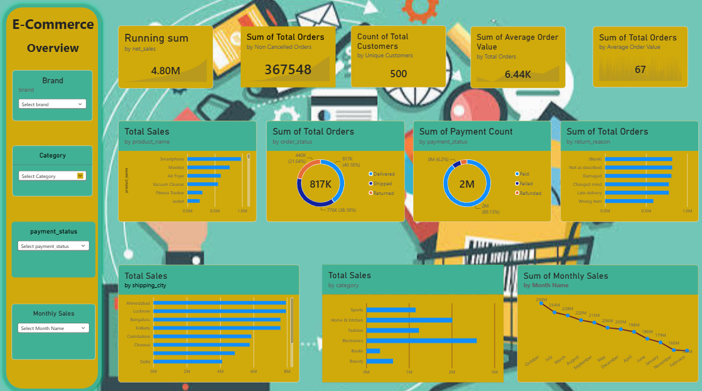

# E-Commerce Data Analysis

## Project Overview

This project focuses on analyzing e-commerce business data to understand sales performance, customer behavior, product performance, orders and payment trends.

I used Excel, MySQL and Power BI to explore the data, perform analysis and build an interactive dashboard.

## Tools Used

- Microsoft Excel – Data cleaning and preparation
- MySQL Workbench – SQL queries and data analysis
- Power BI – Dashboard development and visualization

## Project Workflow

1. Collected and explored the e-commerce datasets.
2. Cleaned the data using Excel.
3. Analyzed business data using SQL.
4. Created DAX measures in Power BI.
5. Developed an interactive dashboard to understand business performance.

## Dashboard Preview

## Key Analysis

- Total sales analysis
- Customer analysis
- Product-wise sales
- Category-wise sales
- Order status analysis
- Payment status analysis
- Return reason analysis
- Monthly sales trends
- City-wise sales performance

## Project Files

- Dataset – Raw and prepared CSV files
- Excel – Data cleaning work
- SQL – SQL queries
- Power BI – Dashboard and report

## Conclusion

This project helped me understand how data can be cleaned, analyzed and transformed into meaningful business insights using Excel, SQL and Power BI.

